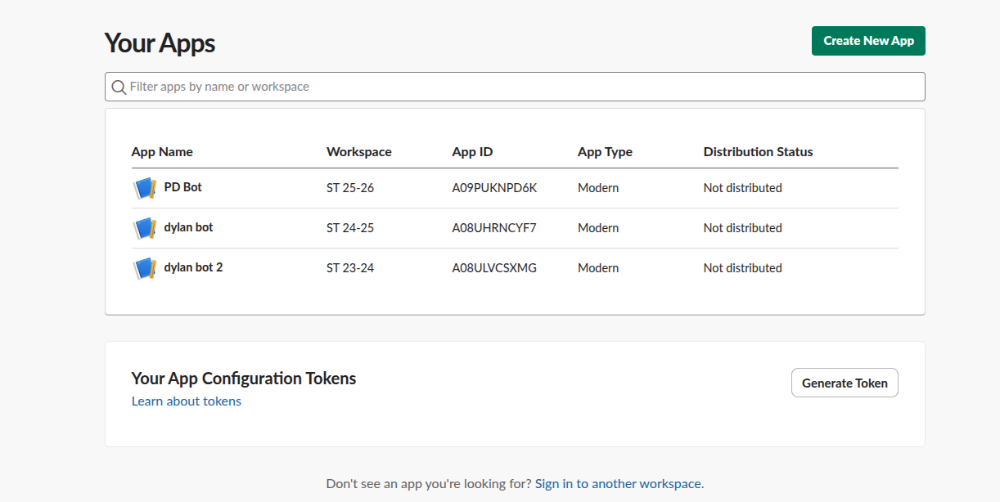
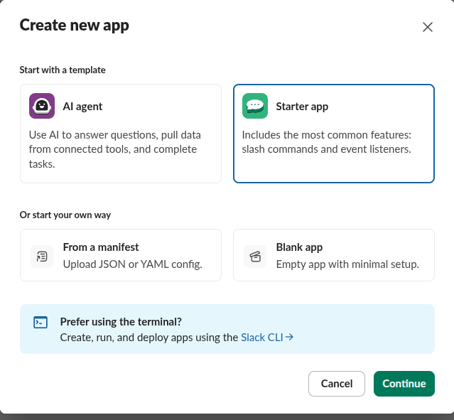
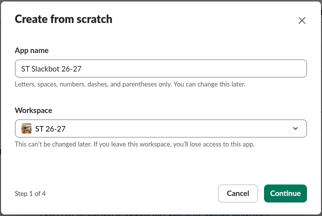
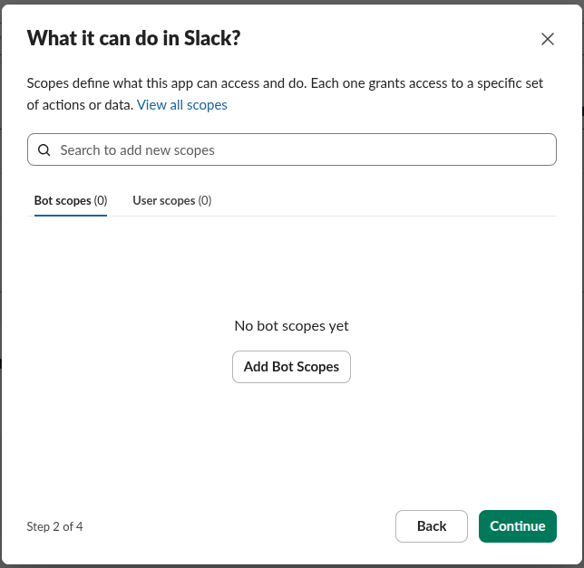
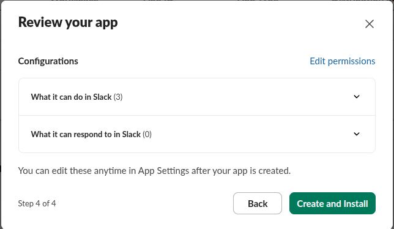
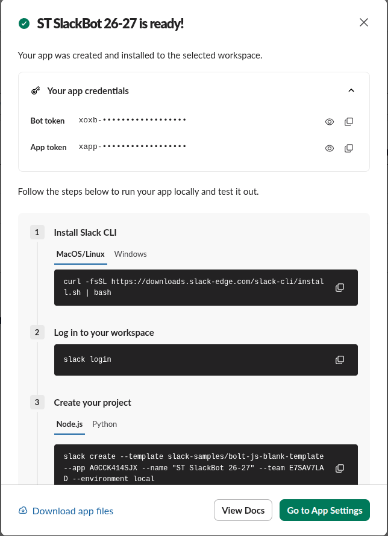

# Adding a Slack Bot/App to the Workspace

This guide walks through creating and installing the **ST SlackBot** App in your Slack Workspace to generate a bot OAuth token (`xoxb-...`).

---

### Step 1: Open the Slack Apps Dashboard
1. Navigate to [https://api.slack.com/apps](https://api.slack.com/apps) and sign into your Slack account.
2. You will see the Slack Your Apps dashboard:

---

### Step 2: Create a New App
Press the green **"Create New App"** button in the top right corner.

---

### Step 3: Choose App Configuration Type
Select **"From scratch"** (or **"Blank app"**) and click **Continue**.

---

### Step 4: Name the App & Select Workspace
1. **App Name**: Enter `ST SlackBot` (or your preferred name).
2. **Pick a workspace to develop your app in**: Select your target Slack Workspace from the dropdown.
   > [!NOTE]
   > You must already be a member of the workspace with permission to install apps.

---

### Step 5: Configure Bot Token Scopes
1. In the sidebar under **Features**, navigate to **OAuth & Permissions**.
2. Scroll down to the **Scopes** section.
3. Under **Bot Token Scopes**, click **Add an OAuth Scope** and add the following 3 permissions:
   - `chat:write` — Allows the bot to post messages to channels and direct messages.
   - `im:write` — Allows the bot to start and send direct messages to workspace members.
   - `users:read` — Allows the bot to query workspace users and map member names to Slack User IDs.

---

### Step 6: Skip Interactive / Event Features
Press **Continue**. You can skip the next page because the ST SlackBot operates as a one-way feedback dispatcher and does not require incoming webhook or interactive event subscriptions. Click **Continue** again.

---

### Step 7: Install App to Workspace & Copy Bot Token
1. Review the configured scopes.
2. Press **"Create and Install"** (or **"Install to Workspace"**).
3. A Slack authorization prompt will appear asking you to confirm access permissions for the workspace. Click **Allow**.

4. Once authorized, copy the generated **Bot User OAuth Token** (starts with `xoxb-`).
5. Save this token:
   - In Streamlit Cloud: Paste into **App Settings → Secrets** as `SLACK_BOT_TOKEN = "xoxb-..."`.
   - Locally: Paste into `.streamlit/secrets.toml` or directly into the **Slack Bot Token** field under the sidebar in the app.

> [!TIP]
> After saving the token in the ST SlackBot GUI, click **🧪 Test Slack Connection** to verify that your bot is connected and ready to send feedback.
